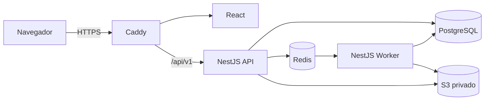

# Arquitectura

Mediagnostics es un monolito modular con dos procesos NestJS independientes. El API atiende solicitudes HTTP y encola trabajos; el Worker procesa los PDF fuera del ciclo de petición. Ambos comparten las reglas ubicadas en `src/`.

## Módulos

La aplicación se divide en `auth`, `users`, `access-control`, `documents`, `processing`, `storage`, `audit`, `notifications` y `health`. Cada módulo separa `domain`, `application`, `infrastructure` y `presentation` cuando esas capas sean necesarias.

## Procesamiento documental

El API valida tamaño, firma y MIME del PDF antes de almacenarlo. BullMQ crea un trabajo con hasta tres intentos, espera exponencial, 60 segundos de tiempo máximo y concurrencia inicial de uno. El Worker rechaza PDF cifrados, dañados o con contenido activo; calcula SHA-256, extrae metadatos, genera una vista previa WebP y produce una copia protegida con AES-256.

El Worker ejecuta `qpdf`, `pdfinfo`, `pdftoppm` y `cwebp` sin usar un intérprete de comandos. Cada trabajo utiliza un directorio temporal con permisos restrictivos que se elimina al finalizar. La contraseña del PDF contiene 16 caracteres aleatorios sin símbolos ambiguos y se persiste exclusivamente cifrada mediante AES-256-GCM.

El API y el Worker se construyen como imágenes separadas sobre Debian Bookworm Slim y se ejecutan como el usuario no privilegiado `node`. Solo la imagen del Worker contiene las herramientas PDF, reduciendo la superficie de ataque del API.

La carga acepta exclusivamente PDF de hasta 10 MB mediante `multipart/form-data`. Los objetos se mantienen privados bajo `patients/{patientId}/documents/{documentId}/`. Un borrador no entra a la cola. Si PostgreSQL falla después de cargar el original, el API elimina el objeto; si Redis falla, conserva el documento en estado `FAILED`. El operador puede solicitar hasta tres reintentos manuales y eliminar definitivamente documentos `DRAFT` o `FAILED`.

La anulación es una transición atómica de `PUBLISHED` a `ANNULLED`, reservada al administrador y acompañada por una justificación de 10 a 500 caracteres. Se conservan los archivos privados y el historial de auditoría, se registra una notificación y el cambio de estado revoca inmediatamente la vista previa, descarga y contraseña del paciente.

Durante una carga, el operador puede enlazar opcionalmente un documento `ANNULLED` del mismo paciente y tipo. La relación es inmutable y uno a uno: un documento anulado admite como máximo un reemplazo. La elegibilidad se vuelve a comprobar dentro de la transacción de creación para evitar enlaces duplicados o desactualizados.

El historial del paciente solo expone la referencia al reemplazo cuando este alcanza `PUBLISHED`. Los reemplazos en borrador, cola, procesamiento, error o listos para revisión permanecen ocultos, incluso al consultar directamente el API.

## Auditoría

Los eventos son inmutables y registran actor, acción, resultado, recurso, dirección IP, agente de usuario y metadatos mínimos. El administrador puede filtrar por fechas, actor, acción y resultado. La exportación CSV se genera en el servidor, neutraliza fórmulas de hojas de cálculo, se limita a 10.000 filas y produce a su vez un evento `audit.export`.

## Notificaciones

Las notificaciones son internas y no dependen de SES ni de otros servicios restringidos por AWS Academy. Cada cuenta puede consultar sus 20 eventos más recientes, ver el contador de no leídos y marcar uno o todos como leídos. La publicación, el reemplazo y la anulación documental crean notificaciones para el paciente dentro de la misma transacción que cambia el estado del documento.

## Salud del sistema

El endpoint público de readiness comprueba PostgreSQL, Redis, S3 y el heartbeat del Worker, pero solo devuelve disponibilidad general o HTTP `503`. El diagnóstico detallado está protegido por `system:health:read` y muestra estado y latencia por componente. El Worker renueva en Redis un heartbeat con TTL de 30 segundos; la ausencia del proceso expira automáticamente sin requerir un servicio adicional.

En desarrollo se usa SeaweedFS en modo servidor único como emulador de la API S3. En AWS Academy se usa un bucket S3 privado y la instancia EC2 obtiene acceso mediante `LabInstanceProfile`; no se almacenan claves AWS en el proyecto.
